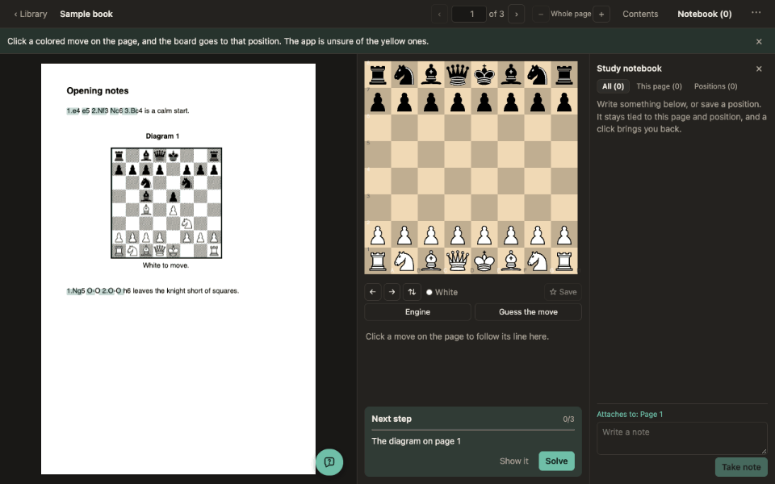
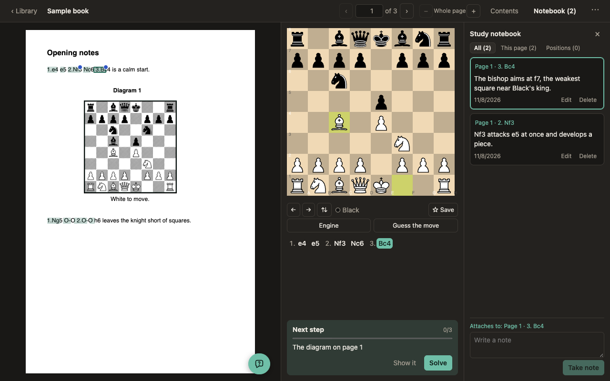
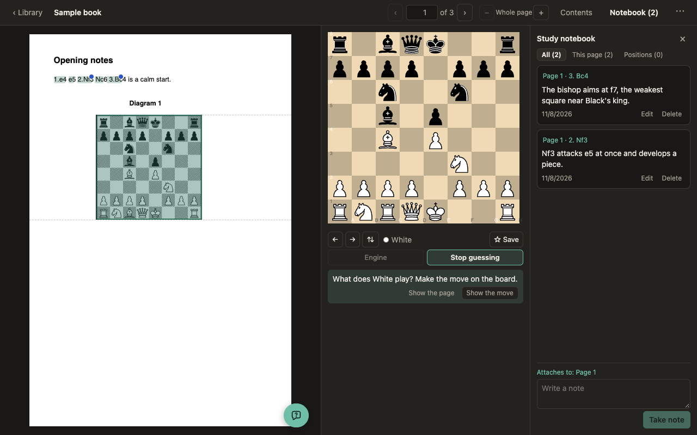
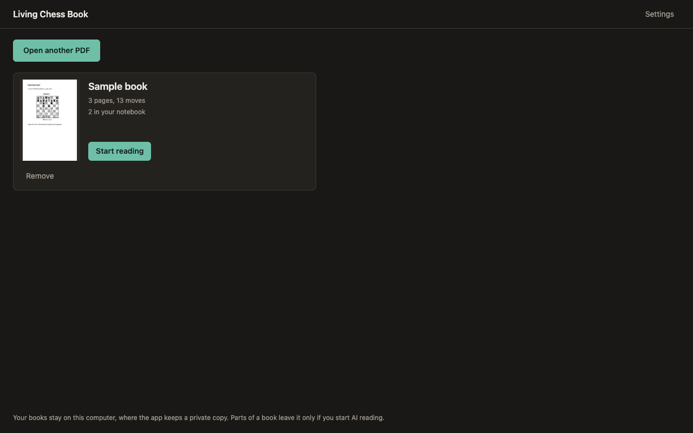

# Living Chess Book

**Study the chess books you own, on one screen.** Open a PDF, click its moves and diagrams to see them
on a live board, check lines with an engine, keep notes beside the page, and ask a coach. Everything
runs on your computer.

[](LICENSE)
[](https://github.com/FARUK-YILDIRIM/living-chess-book/releases)
[](#install)



## What it does

The book's own pages stay as they are. Its moves and diagrams become clickable, and the board follows.

- **Read with a live board.** Click a move or diagram, step through lines with the arrow keys, and
  try your own moves.
- **Check with an engine.** Stockfish runs on your computer, with a bar, arrows, its best lines and
  how the book's move compares.
- **Study actively.** Solve diagrams and guess the book's moves, with what follows hidden on the page.
- **Keep a notebook.** Notes and saved positions attach to the page and position by themselves, and
  come back for practice at growing intervals.
- **Ask a coach**, if you connect an AI provider of your choice.

<table>
  <tr>
    <td width="50%"><p align="center">Notes tied to the book's moves</p></td>
    <td width="50%"><p align="center">The engine's view of the position</p></td>
  </tr>
  <tr>
    <td width="50%"><p align="center">Solving a diagram from the book</p></td>
    <td width="50%"><p align="center">Your library, kept on your computer</p></td>
  </tr>
</table>

## Install

**Chrome Web Store:** under review. A link will be here when it is published.

**Until then**, or to try the latest version:

1. Download `living-chess-book-<version>.zip` from the
   [Releases](https://github.com/FARUK-YILDIRIM/living-chess-book/releases) page, and unzip it.
2. Open `chrome://extensions` (or `edge://extensions`) and turn on **Developer mode**.
3. Choose **Load unpacked**, and pick the unzipped folder.
4. Click the Living Chess Book button in the toolbar. Try the sample book, or open a PDF of your own.

An unpacked extension keeps its books and notes only while it is loaded from the same folder.

## Private by design

- Your books, notes and settings stay in your browser, on your computer. There are no accounts, no
  analytics and no servers of our own.
- The engine runs on your computer.
- AI reading and the coach are optional. They send only what they say they send, only after you
  agree, and only to the provider you chose, with your own API key.
- The extension asks for no access to the websites you visit.

See [PRIVACY.md](PRIVACY.md).

## Status

**An early version.** It works best with digital PDFs whose text can be selected.

- On one digital book, the local reader got about 90% to 97% of the main line moves right.
- On a hard scanned book it got about half, against a target of 95%. On a small sample of that book,
  AI reading with DeepSeek reached 87%, and a stand-in for an API had reached 99%.
- Diagrams did well without AI.
- The coach has been tried with DeepSeek, but no strong player has judged its advice.

See [docs/spike-results.md](docs/spike-results.md). The app lists what it was unsure of, so that you
can check and correct it.

## Features in detail

- Shows the book's original pages, with clickable moves and diagrams.
- Reads diagrams into positions, and moves into a tree of main and side lines.
- Lets you step through lines with the arrow keys, and try your own moves on the board.
- Lists what it is unsure about, so that you can check and correct it.
- Keeps your books in a library on the first screen, so that one click opens a book at the
  page you left it. For this it keeps a private copy of each PDF on your computer.
- Remembers its analysis and your corrections. An analysis or a notebook can be saved to a file and
  opened by someone with the very same PDF, or kept as a backup. Neither holds book text or page images.
- Can read doubtful lines again with an AI model, if you choose to.
- Keeps a study notebook beside the page. Notes and saved positions attach to the page and position
  by themselves, and a click brings you back. You can select text on the page to mark it.
- Runs Stockfish on your computer, and shows its best lines to click through.
- Lets you solve diagrams and guess the book's moves, with what follows covered on the page. A move
  that is not the book's gets the engine's view of it.
- Brings saved positions back for practice at growing intervals, and moves you missed sooner.
- Shows how many diagrams you have solved, and leads to the next.
- Answers questions through an AI coach, if you connect one.

See [docs/SPEC.md](docs/SPEC.md) and the [decision records](docs/adr).

### The coach

This is optional, and uses the same provider as AI reading. Select **Ask the coach** on the page or
press C to open its window, or select text on the page and choose **Explain**.

- **What is sent:** your question, the page number, the position, the book's line, Stockfish's
  lines, your notes on this position, your last few exchanges and any text you selected. You agree to
  the place it goes, named in the coach's window, before anything is sent, and can read exactly what
  went. The text of the whole page goes only if you tick a second box.
- **How replies are checked:** every move must be legal from the position to be clickable. Others
  are struck through with a warning. This catches illegal moves, not bad advice, so treat the coach
  as a study partner. It is told to rely on the engine for calculation.
- **Limits:** only DeepSeek has been tried, on a small set of questions. A reply can take up to a
  minute.

### AI reading

This is optional and off until you start it. Choose a provider in Settings, then start it from
**Fix the reading** in a book's menu, or choose it when you add a book. There are three ways to pay
for it:

- **Your own API key**, from Anthropic, DeepSeek or any OpenAI-compatible service.
- **A model on your own computer**, such as through Ollama, with no account at all. In the extension,
  Ollama may need `OLLAMA_ORIGINS` set to let the extension in.
- **A ChatGPT Plus or Pro plan, with no API key**, in the web app only. Choose it in Settings and
  select **Continue with ChatGPT**. It uses what your plan includes, and a long book can reach a
  limit. It is an OpenAI preview, and needs `npm run dev`, because a small local helper holds the
  sign-in. See [ADR-0012](docs/adr/0012-chatgpt-plan-through-a-local-helper.md). Claude and Gemini
  subscriptions cannot be used this way, because their terms do not allow it.

What else to know:

- **What is sent:** images cropped to the lines being read, with the starting position. You
  see how many and an estimated cost, and tick a box for each run. The provider's terms apply,
  so only do this with a book you may share this way.
- **Your key:** kept in memory until you close the app, unless you tick the box to remember
  it. Then it is saved on this computer, encrypted, but someone with access to your account
  could still recover it, so do not use this on a shared computer. You can forget your keys at
  any time.
- **How replies are checked:** every move must be legal from the diagram, and is matched with
  the words on the page. A move with no match goes to the Check tab. Your own corrections are
  never replaced.
- **Your ChatGPT sign-in:** kept in `~/.config/chess-coach/` (named before the project was),
  readable only by you. The app's pages never see it. Signing out ends it at OpenAI.
- **Limits:** it reads main lines only. Only DeepSeek's API has run it, on a sample, and not a real
  ChatGPT account.

## Develop

Requires Node.js 22.

```bash
npm install
npm run dev
```

Then open http://localhost:5183. `public/sample-book.pdf` is an original sample book to try it with.

### Build the extension

```bash
npm run build:extension
```

This builds `dist-extension/`, and `release/living-chess-book-<version>.zip` for a store. Load the
folder as in [Install](#install). `npm run preview:extension` serves the same pages with the
extension's security policy, to try them in any browser.

### Test

```bash
npm test
npm run typecheck
```

Automated tests use only original, generated books. To measure accuracy on a book you
own, keeping the book and your hand-checked lines outside the repository:

```bash
npm run eval:local -- /path/to/book.pdf /path/to/truth.json
```

It prints aggregate numbers only. `npm run eval:llm` does the same for AI reading, without
calling any API. See the top of [scripts/eval-llm.ts](scripts/eval-llm.ts).

### Desktop app

The desktop shell is on hold while the extension comes first. It uses [Tauri](https://tauri.app),
which needs [Rust](https://www.rust-lang.org/tools/install) and the
[Tauri prerequisites](https://tauri.app/start/prerequisites/). It has not been compiled yet.

```bash
npm run tauri dev
```

### Contributing

[AGENTS.md](AGENTS.md) explains how work is done here, for people and coding agents alike: the
commands, the process, how commits are written and the rules that are not negotiable, such as no
book content in the repository. Bugs and ideas are welcome as
[issues](https://github.com/FARUK-YILDIRIM/living-chess-book/issues).

## Licence

GPL-3.0-or-later. See [LICENSE](LICENSE). The extension carries the licences of the packages it
includes, such as Stockfish, chessground, chess.js and pdf.js, in `THIRD_PARTY_NOTICES.txt`.
